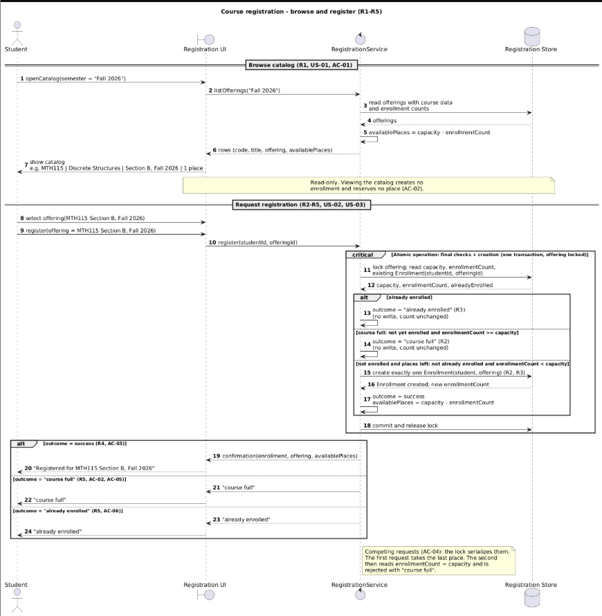
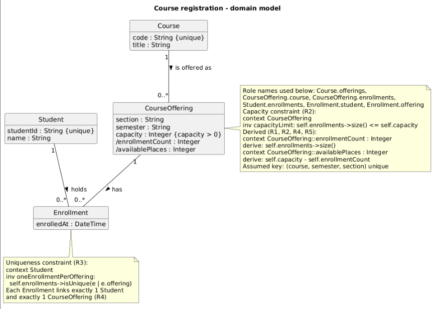
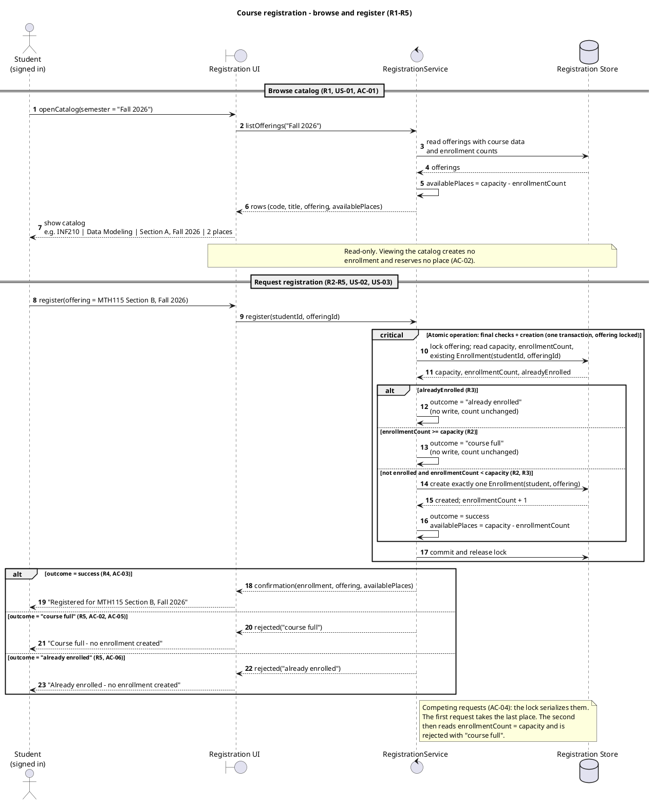
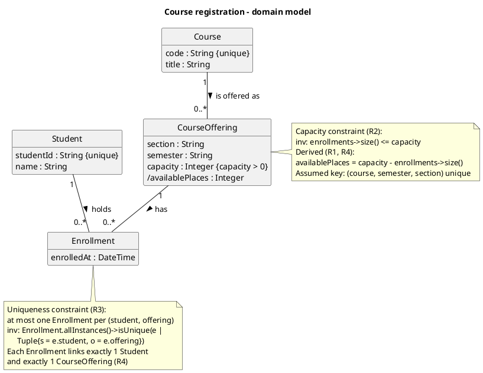
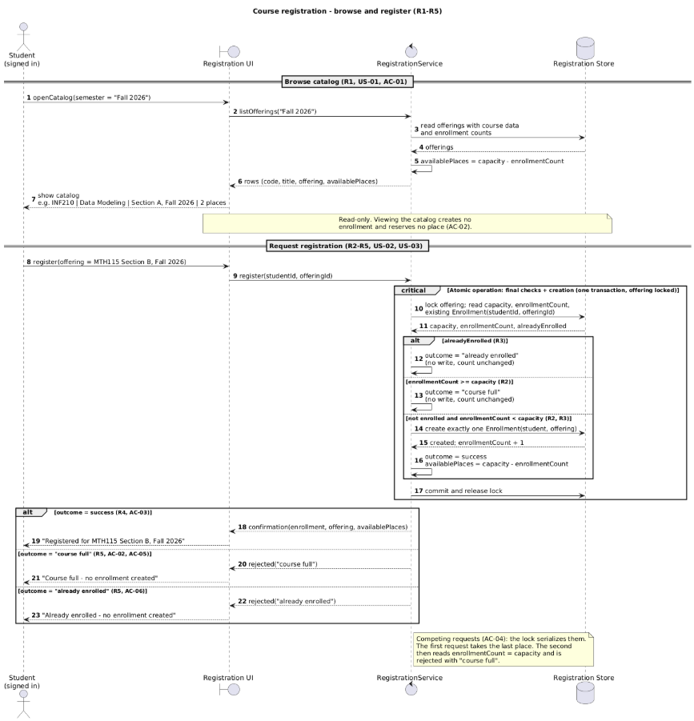
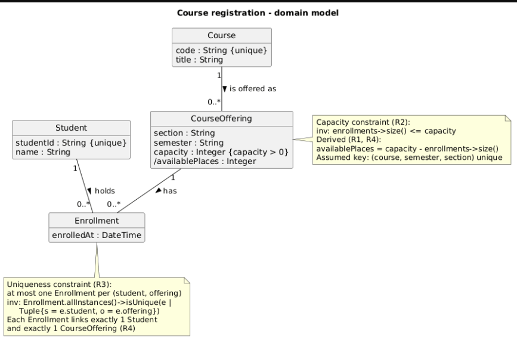

# SIS #02 — AI-Assisted UML Modeling: University Course Registration

<!--
  This is the only file you write your report in. README.md tells you what goes where.

  Rules the checker relies on:
  - Do not delete, rename or renumber the ## headings, the ### headings, or the **Label:** words.
  - Replace every "(write here)" and "(paste here)". None may be left when you submit.
  - Comments like this one are ignored by the checker and the word counter. Delete them or leave them.
-->

## 1. Scope and assumptions

**Scope:** A signed-in student browses the course catalog for one semester, sees the course code, title, offering and available places, selects one CourseOffering and requests registration. At registration the system rechecks, in one atomic step, whether the student is already enrolled and whether places remain, then either creates exactly one Enrollment and returns a confirmation, or rejects the request with "already enrolled" or "course full" and changes nothing. Out of scope: payments, prerequisites, timetable clashes, waiting lists, cancellation, and login itself.

**Assumptions:**

1. The only actor is the Student; no admin or instructor actions are modelled.
2. A Course has one or more CourseOfferings; each CourseOffering belongs to exactly one Course and one semester and has a fixed capacity (a positive whole number).
3. An Enrollment links exactly one Student to exactly one CourseOffering; a student has at most one Enrollment per offering.
4. Available places = capacity minus the current number of Enrollments for the offering. A catalog view shows this figure but reserves nothing, so it can be stale.
5. The duplicate check, the capacity check and the creation of the Enrollment form one atomic operation, so two competing requests cannot both take the last place.
6. If a student is already enrolled and the offering is also full, the duplicate check runs first and the reason returned is "already enrolled".
7. The rejection reason for a full offering is "course full" (the wording R5 requires), not "no places left" as in my first draft.

## 2. User stories and acceptance criteria

<!-- Your APPROVED requirements: Prompt A's draft after your review. Keep the IDs, the three
     story headings and the bullet shape. Every criterion names the rule(s) it maps to,
     e.g. (R2, R4). Two criteria per story. Nothing out of scope.
     Format of a criterion, on one bullet:
     - **AC-03** (R2, R4): Given ..., When ..., Then ... -->

### US-01 — Browse offerings

**US-01:** As a signed-in student, I want to see the course offerings for a semester with their available places, so that I can choose an offering to register for.

- **AC-01** (R1): Given course INF210 "Data Modeling" has offering "Section A, Fall 2026" with capacity 30 and 28 enrollments, When student Aida opens the catalog for Fall 2026, Then the catalog shows code "INF210", title "Data Modeling", offering "Section A, Fall 2026" and 2 available places.
- **AC-02** (R1, R2, R5): Given offering INF210 Section A, Fall 2026 has capacity 30 and 29 enrollments, and student Bolat's catalog view shows 1 available place, When student Dana registers for that offering before Bolat submits a request, Then Dana's enrollment is created, Bolat's catalog view did not create or hold an enrollment, and Bolat's later request is rechecked against current availability and rejected with "course full".

### US-02 — Register for an offering

**US-02:** As a signed-in student, I want to register for a selected course offering, so that I get a place in it and receive a confirmation.

- **AC-03** (R2, R4): Given offering MTH115 "Discrete Structures", Section B, Fall 2026 has capacity 25 and 24 enrollments, and student Aida has no enrollment in it, When Aida requests registration for that offering, Then exactly one Enrollment linking Aida and MTH115 Section B, Fall 2026 is created, available places become 0, and Aida receives a confirmation.
- **AC-04** (R2, R4, R5): Given offering MTH115 Section B, Fall 2026 has capacity 25 and 24 enrollments, and neither Bolat nor Chingiz is enrolled in it, When Bolat and Chingiz request registration at the same time, Then exactly one of them gets an Enrollment and a confirmation, the other is rejected with "course full" and gets no enrollment, and the enrollment count is 25 and never exceeds capacity.

### US-03 — Receive a clear rejection

**US-03:** As a signed-in student, I want to be told why my registration was rejected, so that I know my request did not create an enrollment.

- **AC-05** (R2, R5): Given offering INF210 Section C, Fall 2026 has capacity 20 and 20 enrollments, and student Dana has no enrollment in it, When Dana requests registration for that offering, Then the request is rejected with "course full", no Enrollment is created, and the enrollment count stays 20.
- **AC-06** (R3, R5): Given student Aida already has an Enrollment in offering MTH115 Section B, Fall 2026, which has capacity 25 and 12 enrollments, When Aida requests registration for the same offering again, Then the request is rejected with "already enrolled", no Enrollment is created, and the enrollment count stays 12.

## 3. Sequence diagram

**Participants:** Student (actor) is the signed-in student who browses and registers. Registration UI (boundary) is the screen that shows the catalog and sends the request. RegistrationService (control) applies R2–R5 and owns the atomic operation. Registration Store (database) holds the Course, CourseOffering and Enrollment data.

**Atomic operation:** Messages 11–18 inside the `critical` fragment form one atomic step: lock the offering and read capacity, enrollmentCount and the existing Enrollment (11–12), the duplicate guard `already enrolled`, the capacity guard `course full`, the creation of the Enrollment (15–16) and `commit and release lock` (18). The catalog view (messages 1–7) is read-only and outside this fragment, so it reserves nothing; the count is read again at message 11.

**Where the Enrollment is created:** Message 15, `create exactly one Enrollment(student, offering)`, sent by RegistrationService to Registration Store in the branch `not enrolled and places left`. It produces one instance of the class Enrollment in section 4, linked to one Student and one CourseOffering.

**Technical lifelines:** Registration UI, RegistrationService and Registration Store are not classes in the class diagram. They are design-level participants (boundary, control, database) that show who sends which message and where the transaction happens, while the class diagram shows only the domain concepts Student, Course, CourseOffering and Enrollment. The difference in abstraction is intended: the domain model says what must be true, the lifelines show how a request is processed.

## 4. Class diagram

| Association | Read left to right | Read right to left |
| --- | --- | --- |
| Course "1" -- "0..*" CourseOffering | One Course is offered as zero or more CourseOfferings | Each CourseOffering belongs to exactly one Course |
| Student "1" -- "0..*" Enrollment | One Student holds zero or more Enrollments | Each Enrollment belongs to exactly one Student |
| CourseOffering "1" -- "0..*" Enrollment | One CourseOffering has zero or more Enrollments | Each Enrollment is for exactly one CourseOffering |

**How an Enrollment links a student to an offering:** Enrollment sits between Student and CourseOffering. Its multiplicity is "1" at the Student end and "1" at the CourseOffering end, so every Enrollment links exactly one student to exactly one offering, while a student or an offering can have many Enrollments.

**Capacity constraint:** `context CourseOffering inv capacityLimit: self.enrollments->size() <= self.capacity` (R2). Multiplicity "0..*" only says "any number"; the upper limit is a different number for each offering (its capacity attribute), so it cannot be written as a fixed multiplicity.

**Uniqueness constraint:** `context Student inv oneEnrollmentPerOffering: self.enrollments->isUnique(e | e.offering)` (R3). Multiplicity counts links from one object, but it cannot say anything about pairs: "0..*" on both sides still allows two Enrollments for the same (Student, CourseOffering) pair, so the rule needs a note.

## 5. Traceability

| Rule and criterion | Model evidence | Validation case |
| --- | --- | --- |
| R1 + AC-01, AC-02 | Messages 1–7 (`openCatalog`, `listOfferings`, `rows (code, title, offering, availablePlaces)`); Course.code, Course.title, CourseOffering.semester, /availablePlaces | No T case; extra check: I traced messages 1–7 and confirmed the row shows code, title, offering and available places, and the note says the view reserves no place |
| R2 + AC-02, AC-03, AC-04, AC-05 | Message 11 re-reads enrollmentCount inside `critical`; guard `course full: not yet enrolled and enrollmentCount >= capacity`; capacityLimit note | T2, T3 |
| R3 + AC-06 | Message 11 reads the existing Enrollment; guard `already enrolled`; oneEnrollmentPerOffering note | T4 |
| R4 + AC-03, AC-04 | Message 15 `create exactly one Enrollment`, 16 `Enrollment created; new enrollmentCount`, 17 availablePlaces, 19 `confirmation` after creation | T1, T2 |
| R5 + AC-04, AC-05, AC-06 | Rejection branches 13 and 14 write nothing; replies 21–24 return "course full" / "already enrolled" | T3, T4 |

## 6. Walkthroughs

| Case | Observed path and state change | Judgment and evidence |
| --- | --- | --- |
| T1. Available | Student Aru Bekova (not enrolled) registers for MTH115 Section B. Path: 8 → 9 → 10 → 11 (lock offering, read data) → 12 (capacity = 2, enrollmentCount = 0, alreadyEnrolled = false) → third alt branch: 15 (create Enrollment) → 16 → 17 (availablePlaces = 1) → 18 (commit) → 19 → 20 ("Registered for MTH115 Section B, Fall 2026"). enrollmentCount 0 → 1. | **Pass.** Guard "not already enrolled and enrollmentCount < capacity" (0 < 2) is true, so exactly one Enrollment is created in message 15 and confirmed to the student in messages 19–20. |
| T2. Last place | Student Dias Omarov (not enrolled) registers when one place is left. Path: 8 → 9 → 10 → 11 → 12 (capacity = 2, enrollmentCount = 1, alreadyEnrolled = false) → third alt branch: 15 → 16 → 17 (availablePlaces = 0) → 18 → 19 → 20. enrollmentCount 1 → 2. | **Pass.** Guard 1 < 2 is true, so the last place is taken in message 15. The check (11–12) and creation (15) are inside the `critical` block with the offering locked, and the note on RS shows that a competing request would then read enrollmentCount = capacity and be rejected (AC-04). |
| T3. Full | Earlier the catalog (messages 1–7) showed MTH115 Section B with 1 place (capacity = 2, enrollmentCount = 1), but another student took it before the request. Student Madina Seitova (not enrolled) then registers. Path: 8 → 9 → 10 → 11 (lock offering, re-read data) → 12 (capacity = 2, enrollmentCount = 2, alreadyEnrolled = false) → second alt branch: 14 (outcome = "course full") → 18 (commit, release lock) → 21 → 22 ("course full"). enrollmentCount 2 → 2. | **Pass.** The stale catalog value (1 place) from messages 5–7 is not used for the decision: message 11 re-reads enrollmentCount inside the `critical` block with the offering locked, so the guard "not yet enrolled and enrollmentCount >= capacity" (2 >= 2) is evaluated on the current count. Message 14 states "no write, count unchanged", and the rejection reaches the student in messages 21–22 (R5, AC-02, AC-05). |
| T4. Duplicate | Aru Bekova, already enrolled in MTH115 Section B, sends the same request again. Path: 8 → 9 → 10 → 11 → 12 (capacity = 2, enrollmentCount = 1, alreadyEnrolled = true) → first alt branch: 13 (outcome = "already enrolled") → 18 → 23 → 24 ("already enrolled"). enrollmentCount 1 → 1. | **Pass.** The "already enrolled" guard is checked first, so no second Enrollment is created. Message 13 states "no write, count unchanged", and the student sees the message in 23–24 (R3, R5, AC-06). |

## 7. Review decisions

| AI suggestion or model element | Decision | Reason | Rule |
| --- | --- | --- | --- |
| Prompt C D1: alt guards not mutually exclusive (`alreadyEnrolled` and `enrollmentCount >= capacity` both true for an enrolled student in a full offering) | Modified: kept duplicate-first, guards `already enrolled` / `course full: not yet enrolled and enrollmentCount >= capacity` / `not enrolled and places left` | The defect is real, but the AI's wording started the full guard with "not", which makes it read as a success branch, so I reworded it. | R3, R5 |
| Prompt D unresolved issue: guard 3 condition was only `enrollmentCount < capacity` | Modified after Prompt D by me: guard 3 now says `not already enrolled and enrollmentCount < capacity` | In T4 the old condition 1 < 2 was also true together with guard 1, so the branches still overlapped. | R3 |
| Prompt C D2: add role names to associations | Modified: role names written in the CourseOffering note instead of on the multiplicity labels | The constraints need named navigations, but "student 1" on the link end is not read as a plain multiplicity by the checker (CL4), so I kept "1" and "0..*" on the links. | R2, R3 |
| Prompt C M3: no "select offering" step, catalog row INF210 but request MTH115 | Accepted: added `select offering(MTH115 Section B, Fall 2026)` and changed the catalog row | The scenario says the student chooses an offering, and the request must target what the catalog showed. | R1 |
| Original: rejection replies "Course full - no enrollment created" | Accepted my own inspection (found with Claude): replies now only "course full" / "already enrolled" | A reply that mentions creation inside a rejection branch reads like a state change in a path that must change nothing. | R5 |
| Prompt C O1: add a second Student lifeline for the stale view and competing requests | Rejected | The `critical` fragment and the note already state atomicity, and the assignment says a note is sufficient; a second actor would make the diagram harder to read. | R2 |
| Prompt C O5: model Enrollment as an association class | Rejected | Enrollment is one of the four required class names and an explicit class with a uniqueness note is clearer to read. | R3 |

## 8. Modeling explanation

**Main design choices.** The final checks and the creation of the Enrollment are placed
in one `critical` block with the offering locked. If the check and the write were
separate steps, two students could both read "1 place left" and both be enrolled.
Re-reading enrollmentCount inside the lock also means a stale value shown in the catalog
is never used for the decision. The "already enrolled" check comes first so that a
duplicate request always gets the more precise answer: if the student is already in a
full offering, "course full" would be misleading, because the real reason is the
duplicate. Uniqueness is stated in a note rather than through multiplicity because
multiplicity constrains each association end separately. Student 1 — * Enrollment and
Enrollment * — 1 CourseOffering cannot say "at most one Enrollment per (Student,
CourseOffering) pair"; that rule involves both associations at once, so it needs a
constraint note.

**How the two diagrams complement each other.** The class diagram shows what must always
be true: which classes exist, how they are linked, and which constraints hold. The
sequence diagram shows how and in what order a single request is processed to keep those
rules true. For example, capacity and enrollmentCount appear on CourseOffering in the
class diagram, and the same values appear in the sequence diagram guards
(enrollmentCount < capacity), where they decide which branch runs.

**Why an activity diagram could also help.** An activity diagram would show the decisions
(already enrolled? → full? → create Enrollment) as one continuous flow with decision
nodes, without lifelines or messages. This makes the workflow easier to explain to
people who do not read UML, such as teachers or other students, and makes it easy
to check that every branch ends in a clear outcome.

## 9. Reflection

AI was most useful as a reviewer. In Prompt C the critique pointed out that my guards
overlapped (D1): a student who was already enrolled in a full offering matched both the
"already enrolled" and the "course full" branch. In Prompt D I applied the fix: the
guards became mutually exclusive and the duplicate check comes first, so every request
follows exactly one branch.

One decision I made myself was rejecting the assistant's proposal to add a second
Student lifeline (O1), which would have shown the stale catalog and the simultaneous
requests explicitly. The critical block and its note already show that the check and
the creation of the Enrollment are atomic, the assignment states that a note is enough
for this, and a second actor would have made the diagram harder to read.

The main limitation follows directly from that decision: the competing-requests case
(AC-04) appears only in a note, not as real messages from two students. A reader has to
trust the note instead of following the interleaving step by step, so a separate
diagram with two Student lifelines would show the lock working more convincingly.

## 10. Appendix A — Before AI

**Scope:** A signed-in student browses the electronic course catalog, selects one course offering (a section of a course in a specific semester) and requests
registration; the system creates an Enrollment or rejects the request based on
available places. Out of scope: payments, prerequisites, timetable clashes, waiting lists, cancellation, and login itself.

**Initial assumptions:**

1. The only actor who registers is the Student; the Course Catalog / Registration System is the system under design. No admin or instructor actions are modelled.
2. A Course (e.g. "SE101 Software Engineering") can have many CourseOfferings; each CourseOffering belongs to exactly one Course and one semester and has a fixed capacity (a positive whole number).
3. An Enrollment links exactly one Student to exactly one CourseOffering. A student can have many enrollments, but at most one for the same offering.
4. A registration request is accepted (an Enrollment is created) only if the number of existing enrollments for that offering is less than its capacity; otherwise it is rejected with a "no places left" message. Since waitlists are excluded, nothing happens after a rejection.
5. A duplicate request (the student is already enrolled in that offering) is rejected, and the enrollment count does not change.
6. Two students requesting the last place at the same time must not both succeed, so the capacity check and creating the Enrollment happen as one step.
7. The catalog shows the remaining places for each offering, so the student can see whether it is full before requesting.

## 11. Appendix B — AI exchanges

### B1 — Requirements (Prompt A)

- **Tool:** Claude
- **Model:** Claude Opus 5.5
- **Date:** 2026-10-18
- **Purpose:** draft 3 user stories and 6 acceptance criteria

**Prompt:**

~~~~text
Act as a requirements analyst. Use only this course registration scenario and rules R1–R5: Scenario: A student browses an electronic course catalog, chooses a course offering and requests registration. Each offering has a limited number of places. A Course describes a subject. A CourseOffering is one scheduled section in one semester. Registration always targets a specific offering. Assume that the student is signed in, the selected offering exists, and its capacity is a positive whole number. Exclude payments, prerequisites, timetable clashes, waiting lists and cancellation. Use fictional students and courses. R1. Catalog: Show the course code, title, offering and available places for one semester. R2. Capacity: Recheck current availability when registering. Enrollment must never exceed the offering's capacity. R3. Duplicates: A student may have at most one enrollment in the same offering. Reject a repeat request. R4. Success: Create exactly one Enrollment linking the student and offering, update availability and return a confirmation. R5. Rejection: Explain "course full" or "already enrolled". Create no enrollment and leave the enrollment count unchanged. A catalog view does not reserve a place. Model the final checks and enrollment creation as one atomic operation so competing requests cannot take the same last place. My initial assumptions are 1. The only actor who registers is the Student; the Course Catalog / Registration System is the system under design. No admin or instructor actions are modelled. 2. A Course (e.g. "SE101 Software Engineering") can have many CourseOfferings; each CourseOffering belongs to exactly one Course and one semester and has a fixed capacity (a positive whole number). 3. An Enrollment links exactly one Student to exactly one CourseOffering. A student can have many enrollments, but at most one for the same offering. 4. A registration request is accepted (an Enrollment is created) only if the number of existing enrollments for that offering is less than its capacity; otherwise it is rejected with a "no places left" message. Since waitlists are excluded, nothing happens after a rejection. 5. A duplicate request (the student is already enrolled in that offering) is rejected, and the enrollment count does not change. 6. Two students requesting the last place at the same time must not both succeed, so the capacity check and creating the Enrollment happen as one step. 7. The catalog shows the remaining places for each offering, so the student can see whether it is full before requesting.
Draft 3 user stories and 2 Given / When / Then acceptance criteria for each. Use IDs US-01 to US-03 and AC-01 to AC-06. Map each criterion to rule IDs.
Cover normal and rejection behavior. List uncertainty separately. Do not add excluded features or invent university policies.
~~~~

**Response:**

~~~~text
Course Registration: User Stories and Acceptance Criteria

All students and courses below are fictional.

Notes on your assumptions

Two adjustments keep the assumptions in line with the rules:

Assumption 4: R5 requires the message “course full”. Use that wording instead of “no places left”.
Assumption 6: The rules require all of the final checks to be atomic, not only the capacity check. The duplicate check (R3) should be part of the same atomic step as the capacity check and enrollment creation.

The rest are consistent with R1–R5.

US-01: Browse the catalog

As a signed-in student, I want to see the course offerings for a semester with their available places, so that I can choose an offering to register for.

AC-01: Catalog shows required fields (R1)

Given course INF210 “Data Modeling” has offering “Section A, Fall 2026” with capacity 30 and 28 enrollments
When student Aida opens the catalog for Fall 2026
Then the catalog shows code “INF210”, title “Data Modeling”, offering “Section A, Fall 2026” and 2 available places.

AC-02: Viewing does not reserve a place (R1, R2)

Given offering INF210 Section A, Fall 2026 has capacity 30 and 29 enrollments, and student Bolat’s catalog view shows 1 available place
When student Dana registers for that offering before Bolat submits a request
Then Dana’s enrollment is created, Bolat’s catalog view did not create or hold an enrollment, and Bolat’s later request is rechecked against current availability and rejected with “course full”.
US-02: Register for an offering

As a signed-in student, I want to register for a selected course offering, so that I get a place in it and receive a confirmation.

AC-03: Successful registration (R2, R3, R4)

Given offering MTH115 “Discrete Structures”, Section B, Fall 2026 has capacity 25 and 24 enrollments, and student Aida has no enrollment in it
When Aida requests registration for that offering
Then exactly one Enrollment linking Aida and MTH115 Section B, Fall 2026 is created, available places become 0, and Aida receives a confirmation.

AC-04: Competing requests for the last place (R2, R4, R5)

Given offering MTH115 Section B, Fall 2026 has capacity 25 and 24 enrollments, and neither Bolat nor Chingiz is enrolled in it
When Bolat and Chingiz request registration at the same time
Then exactly one of them gets an Enrollment and a confirmation, the other is rejected with “course full” and gets no enrollment, and the enrollment count is 25. It never exceeds capacity.
US-03: Understand a rejected request

As a signed-in student, I want to be told why my registration was rejected, so that I know my request did not create an enrollment.

AC-05: Offering is full (R2, R5)

Given offering INF210 Section C, Fall 2026 has capacity 20 and 20 enrollments, and student Dana has no enrollment in it
When Dana requests registration for that offering
Then the request is rejected with “course full”, no Enrollment is created, and the enrollment count stays 20.

AC-06: Already enrolled (R3, R5)

Given student Aida already has an Enrollment in offering MTH115 Section B, Fall 2026, which has capacity 25 and 12 enrollments
When Aida requests registration for the same offering again
Then the request is rejected with “already enrolled”, no Enrollment is created, and the enrollment count stays 12.
Traceability
Rule	Acceptance criteria
R1	AC-01, AC-02
R2	AC-02, AC-03, AC-04, AC-05
R3	AC-03, AC-06
R4	AC-03, AC-04
R5	AC-02, AC-04, AC-05, AC-06
Uncertainties (not covered by R1–R5)
Which reason wins: If a student is already enrolled in an offering that is also full, the rules don’t say whether the message should be “already enrolled” or “course full”.
Which semester is shown: R1 says “one semester” but not how it is chosen (the current semester, or one the student selects).
Offering display: It is unspecified what identifies an offering in the catalog, such as a section label, semester, or other details.
Confirmation contents: R4 requires a confirmation but doesn’t define what it includes.
How availability is calculated: It could be derived as capacity minus enrollments or stored as a counter. The rules require only that it stays correct.
Full offerings in the catalog: The rules don’t say whether full offerings are listed with 0 places or hidden. Assumption 7 implies they are listed.
Fixed capacity: Capacity is “fixed” only in your assumption 2. The rules don’t address capacity changes.
Same student submitting twice at once: The rules imply but don’t explicitly state that the atomic operation also stops a student from creating two enrollments by sending simultaneous duplicate requests.
Freshness of the catalog figure: It is unspecified how up to date the displayed available places must be, since a catalog view can become stale (see AC-02).
~~~~

### B2 — UML drafts (Prompt B)

- **Tool:** Claude
- **Model:** Claude Opus 5.5
- **Date:** 2026-10-18
- **Purpose:** draft the sequence and class diagrams

**Prompt:**

~~~~text
Using my approved scenario, R1–R5, stories and criteria below, return separate PlantUML code blocks for a sequence diagram and a domain class diagram.
Sequence: include catalog browsing and guarded success, full-course and duplicate outcomes. Model final checks and creation as one atomic operation.
Class: show domain concepts, useful attributes and multiplicities. State the capacity and uniqueness constraints. Explain assumptions and any technical lifelines.

Approved scenario and rules R1–R5:
Scenario: A student browses an electronic course catalog, chooses a course offering and requests registration. Each offering has a limited number of places. A Course describes a subject. A CourseOffering is one scheduled section in one semester. Registration always targets a specific offering. Assume that the student is signed in, the selected offering exists, and its capacity is a positive whole number. Exclude payments, prerequisites, timetable clashes, waiting lists and cancellation. Use fictional students and courses. R1. Catalog: Show the course code, title, offering and available places for one semester. R2. Capacity: Recheck current availability when registering. Enrollment must never exceed the offering's capacity. R3. Duplicates: A student may have at most one enrollment in the same offering. Reject a repeat request. R4. Success: Create exactly one Enrollment linking the student and offering, update availability and return a confirmation. R5. Rejection: Explain "course full" or "already enrolled". Create no enrollment and leave the enrollment count unchanged. A catalog view does not reserve a place. Model the final checks and enrollment creation as one atomic operation so competing requests cannot take the same last place.

Approved stories and criteria:

US-01 — Browse offerings
US-01: As a signed-in student, I want to see the course offerings for a semester with their available places, so that I can choose an offering to register for.
- AC-01 (R1): Given course INF210 "Data Modeling" has offering "Section A, Fall 2026" with capacity 30 and 28 enrollments, When student Aida opens the catalog for Fall 2026, Then the catalog shows code "INF210", title "Data Modeling", offering "Section A, Fall 2026" and 2 available places.
- AC-02 (R1, R2, R5): Given offering INF210 Section A, Fall 2026 has capacity 30 and 29 enrollments, and student Bolat's catalog view shows 1 available place, When student Dana registers for that offering before Bolat submits a request, Then Dana's enrollment is created, Bolat's catalog view did not create or hold an enrollment, and Bolat's later request is rechecked against current availability and rejected with "course full".

US-02 — Register for an offering
US-02: As a signed-in student, I want to register for a selected course offering, so that I get a place in it and receive a confirmation.
- AC-03 (R2, R4): Given offering MTH115 "Discrete Structures", Section B, Fall 2026 has capacity 25 and 24 enrollments, and student Aida has no enrollment in it, When Aida requests registration for that offering, Then exactly one Enrollment linking Aida and MTH115 Section B, Fall 2026 is created, available places become 0, and Aida receives a confirmation.
- AC-04 (R2, R4, R5): Given offering MTH115 Section B, Fall 2026 has capacity 25 and 24 enrollments, and neither Bolat nor Chingiz is enrolled in it, When Bolat and Chingiz request registration at the same time, Then exactly one of them gets an Enrollment and a confirmation, the other is rejected with "course full" and gets no enrollment, and the enrollment count is 25 and never exceeds capacity.

US-03 — Receive a clear rejection
US-03: As a signed-in student, I want to be told why my registration was rejected, so that I know my request did not create an enrollment.
- AC-05 (R2, R5): Given offering INF210 Section C, Fall 2026 has capacity 20 and 20 enrollments, and student Dana has no enrollment in it, When Dana requests registration for that offering, Then the request is rejected with "course full", no Enrollment is created, and the enrollment count stays 20.
- AC-06 (R3, R5): Given student Aida already has an Enrollment in offering MTH115 Section B, Fall 2026, which has capacity 25 and 12 enrollments, When Aida requests registration for the same offering again, Then the request is rejected with "already enrolled", no Enrollment is created, and the enrollment count stays 12.
~~~~

**Response:**

~~~~text
Sequence diagram
plantuml
@startuml
title Course registration - browse and register (R1-R5)
autonumber

actor "Student\n(signed in)" as S
boundary "Registration UI" as UI
control "RegistrationService" as RS
database "Registration Store" as DB

== Browse catalog (R1, US-01, AC-01) ==
S -> UI : openCatalog(semester = "Fall 2026")
UI -> RS : listOfferings("Fall 2026")
RS -> DB : read offerings with course data\nand enrollment counts
DB --> RS : offerings
RS -> RS : availablePlaces = capacity - enrollmentCount
RS --> UI : rows (code, title, offering, availablePlaces)
UI --> S : show catalog\ne.g. INF210 | Data Modeling | Section A, Fall 2026 | 2 places
note over UI, DB
  Read-only. Viewing the catalog creates no
  enrollment and reserves no place (AC-02).
end note

== Request registration (R2-R5, US-02, US-03) ==
S -> UI : register(offering = MTH115 Section B, Fall 2026)
UI -> RS : register(studentId, offeringId)

critical Atomic operation: final checks + creation (one transaction, offering locked)
  RS -> DB : lock offering; read capacity, enrollmentCount,\nexisting Enrollment(studentId, offeringId)
  DB --> RS : capacity, enrollmentCount, alreadyEnrolled
  alt alreadyEnrolled (R3)
    RS -> RS : outcome = "already enrolled"\n(no write, count unchanged)
  else enrollmentCount >= capacity (R2)
    RS -> RS : outcome = "course full"\n(no write, count unchanged)
  else not enrolled and enrollmentCount < capacity (R2, R3)
    RS -> DB : create exactly one Enrollment(student, offering)
    DB --> RS : created; enrollmentCount + 1
    RS -> RS : outcome = success\navailablePlaces = capacity - enrollmentCount
  end
  RS -> DB : commit and release lock
end

alt outcome = success (R4, AC-03)
  RS --> UI : confirmation(enrollment, offering, availablePlaces)
  UI --> S : "Registered for MTH115 Section B, Fall 2026"
else outcome = "course full" (R5, AC-02, AC-05)
  RS --> UI : rejected("course full")
  UI --> S : "Course full - no enrollment created"
else outcome = "already enrolled" (R5, AC-06)
  RS --> UI : rejected("already enrolled")
  UI --> S : "Already enrolled - no enrollment created"
end

note right of RS
  Competing requests (AC-04): the lock serializes them.
  The first request takes the last place. The second
  then reads enrollmentCount = capacity and is
  rejected with "course full".
end note
@enduml
Domain class diagram
plantuml
@startuml
title Course registration - domain model
hide methods
hide circle

class Student {
  studentId : String {unique}
  name : String
}

class Course {
  code : String {unique}
  title : String
}

class CourseOffering {
  section : String
  semester : String
  capacity : Integer {capacity > 0}
  /availablePlaces : Integer
}

class Enrollment {
  enrolledAt : DateTime
}

Course "1" -- "0..*" CourseOffering : is offered as >
Student "1" -- "0..*" Enrollment : holds >
CourseOffering "1" -- "0..*" Enrollment : has >

note right of CourseOffering
  Capacity constraint (R2):
  inv: enrollments->size() <= capacity
  Derived (R1, R4):
  availablePlaces = capacity - enrollments->size()
  Assumed key: (course, semester, section) unique
end note

note bottom of Enrollment
  Uniqueness constraint (R3):
  at most one Enrollment per (student, offering)
  inv: Enrollment.allInstances()->isUnique(e |
       Tuple{s = e.student, o = e.offering})
  Each Enrollment links exactly 1 Student
  and exactly 1 CourseOffering (R4)
end note
@enduml
Assumptions
Check order: The duplicate check runs before the capacity check, so a student who is already enrolled in a full offering sees “already enrolled”. The rules don’t set this order; it was listed as open earlier.
Available places are derived: They are calculated as capacity minus the enrollment count, not stored as a separate counter. “Update availability” (R4) happens because the enrollment count goes up.
Semester is an attribute: It is modeled as a plain attribute of CourseOffering, because the rules only use it to filter the catalog. No Semester class is added.
Assumed offering key: The key (course, semester, section) is my assumption, not a stated rule.
Confirmation is not an entity: It is a reply message, not a domain class. The rules don’t require storing it.
Scope limits: The diagrams model no actor other than Student, no capacity changes, and none of the excluded features.
Technical lifelines
Registration UI (boundary): the screen through which the student browses the catalog and submits requests.
RegistrationService (control): applies R2–R5 and owns the atomic operation.
Registration Store (database): holds Course, CourseOffering and Enrollment data.

These three are design placeholders, not domain concepts. The critical fragment stands for one transaction with the offering locked. A database unique constraint on (student, offering) would also enforce R3 as a second safeguard.
~~~~

### B3 — Model critique (Prompt C)

- **Tool:** Claude
- **Model:** Claude Opus 5.5
- **Date:** 2026-10-18
- **Purpose:** review both models against R1–R5 and T1–T4

**Prompt:**

~~~~text
Review these two UML models against R1–R5 and my acceptance criteria. Check message order, guards, state changes, multiplicities and naming.
Inspect the four validation cases: available places, exactly one place, full course after a stale catalog view, and duplicate registration.
For each issue, cite the affected rule and model element. Explain the impact and propose a focused correction. Separate genuine defects from optional design choices.

Rules R1–R5: R1. Catalog: Show the course code, title, offering and available places for one semester. R2. Capacity: Recheck current availability when registering. Enrollment must never exceed the offering's capacity. R3. Duplicates: A student may have at most one enrollment in the same offering. Reject a repeat request. R4. Success: Create exactly one Enrollment linking the student and offering, update availability and return a confirmation. R5. Rejection: Explain "course full" or "already enrolled". Create no enrollment and leave the enrollment count unchanged.

Validation cases: T1 Available: capacity 2, enrolled 0, new student -> accept, count becomes 1. T2 Last place: capacity 2, enrolled 1, new student -> accept, count becomes 2. T3 Full: catalog showed a place, current count is 2 of 2 -> reject as full, count stays 2. T4 Duplicate: capacity 2, enrolled 1, that student requests again -> reject as duplicate, count stays 1.

Sequence diagram:

Class diagram:

Approved stories and criteria:

US-01: As a signed-in student, I want to see the course offerings for a semester with their available places, so that I can choose an offering to register for.
- AC-01 (R1): Given course INF210 "Data Modeling" has offering "Section A, Fall 2026" with capacity 30 and 28 enrollments, When student Aida opens the catalog for Fall 2026, Then the catalog shows code "INF210", title "Data Modeling", offering "Section A, Fall 2026" and 2 available places.
- AC-02 (R1, R2, R5): Given offering INF210 Section A, Fall 2026 has capacity 30 and 29 enrollments, and student Bolat's catalog view shows 1 available place, When student Dana registers for that offering before Bolat submits a request, Then Dana's enrollment is created, Bolat's catalog view did not create or hold an enrollment, and Bolat's later request is rechecked against current availability and rejected with "course full".

US-02: As a signed-in student, I want to register for a selected course offering, so that I get a place in it and receive a confirmation.
- AC-03 (R2, R4): Given offering MTH115 "Discrete Structures", Section B, Fall 2026 has capacity 25 and 24 enrollments, and student Aida has no enrollment in it, When Aida requests registration for that offering, Then exactly one Enrollment linking Aida and MTH115 Section B, Fall 2026 is created, available places become 0, and Aida receives a confirmation.
- AC-04 (R2, R4, R5): Given offering MTH115 Section B, Fall 2026 has capacity 25 and 24 enrollments, and neither Bolat nor Chingiz is enrolled in it, When Bolat and Chingiz request registration at the same time, Then exactly one of them gets an Enrollment and a confirmation, the other is rejected with "course full" and gets no enrollment, and the enrollment count is 25 and never exceeds capacity.

US-03: As a signed-in student, I want to be told why my registration was rejected, so that I know my request did not create an enrollment.
- AC-05 (R2, R5): Given offering INF210 Section C, Fall 2026 has capacity 20 and 20 enrollments, and student Dana has no enrollment in it, When Dana requests registration for that offering, Then the request is rejected with "course full", no Enrollment is created, and the enrollment count stays 20.
- AC-06 (R3, R5): Given student Aida already has an Enrollment in offering MTH115 Section B, Fall 2026, which has capacity 25 and 12 enrollments, When Aida requests registration for the same offering again, Then the request is rejected with "already enrolled", no Enrollment is created, and the enrollment count stays 12.
~~~~

**Response:**

~~~~text
UML Review: Course Registration Models

The two models satisfy R1–R5 for all four validation cases. Two genuine defects remain, in the alt guards and the class-diagram constraints, plus three minor consistency issues. Each has a focused fix below.

Validation cases
Case	Path through the sequence diagram	Result
T1 Available (cap 2, count 0, new student)	Third alt operand: guard not enrolled and 0 < 2 → create Enrollment → count 1, available 1, confirmation	Pass (R2, R4)
T2 Last place (cap 2, count 1, new student)	Third operand: 1 < 2 → create → count 2, available 0, confirmation	Pass (R2, R4)
T3 Full after stale view (count 2 of 2)	The count is re-read inside critical, so the catalog value is ignored. Second operand: 2 >= 2 → “course full”, no write, count stays 2	Pass (R2, R5). The stale-view situation appears only in notes, not as messages (see O1).
T4 Duplicate (cap 2, count 1, same student)	First operand: alreadyEnrolled → “already enrolled”, no write, count stays 1	Pass (R3, R5)

Message order is correct throughout. The lock and re-read come before any decision. The commit comes before any reply. The catalog read is outside the atomic block and writes nothing.

Genuine defects
D1. The alt guards are not mutually exclusive
Rules: R3, R5
Element: sequence diagram, alt inside critical
Problem: UML does not evaluate alt operands top to bottom. Each chosen operand must have a true guard, and if several guards are true, the choice is undefined. Take a student who is already enrolled in a full offering, for example cap 2, count 2, and that student is one of the two. Then both alreadyEnrolled and enrollmentCount >= capacity are true. The model doesn’t determine which message the student gets. T4 passes only because its offering is not full.
Fix: Make the second guard exclusive. This also records your precedence decision (duplicate before full) in the model.
plantuml
  alt alreadyEnrolled (R3)
    ...
  else not alreadyEnrolled and enrollmentCount >= capacity (R2)
    ...
  else not alreadyEnrolled and enrollmentCount < capacity (R2, R3)
    ...
  end

Note that the “duplicate first” precedence is still an assumption, not a rule. Keep it on your uncertainty list.

D2. The constraints use navigation names the diagram doesn’t define
Rules: R2, R3, R4
Element: class diagram, both notes and all three associations
Problem: The notes refer to enrollments, e.student and e.offering, but the associations have no role names. They also have no context line. As written, the capacity and uniqueness invariants can’t be resolved against the model, so the two key constraints are only informal.
Fix: Add role names and write the constraints with a context.
plantuml
Course "course 1" -- "offerings 0..*" CourseOffering : is offered as >
Student "student 1" -- "enrollments 0..*" Enrollment : holds >
CourseOffering "offering 1" -- "enrollments 0..*" Enrollment : has >

note right of CourseOffering
  context CourseOffering
  inv capacityLimit: self.enrollments->size() <= self.capacity
  derive availablePlaces: self.capacity - self.enrollments->size()
end note

note bottom of Enrollment
  context Student
  inv oneEnrollmentPerOffering:
    self.enrollments->isUnique(e | e.offering)
end note

The Student-context form is simpler than the allInstances() tuple form and says the same thing for R3.

Minor defects (naming and traceability)
M1. enrollmentCount exists only in the sequence diagram
Rules: R2, R5
Elements: sequence guards; class CourseOffering
Impact: The guards and the R5 phrase “count unchanged” refer to a value the domain model never names. A reader can’t trace one model to the other.
Fix: Add a derived attribute /enrollmentCount : Integer to CourseOffering, with derive: self.enrollments->size().
M2. The state change is hidden in a return message
Rule: R4
Element: DB --> RS : created; enrollmentCount + 1
Impact: The reply reads as arithmetic rather than a result. It isn’t clear where availability is updated, which R4 explicitly requires.
Fix: Use DB --> RS : Enrollment created; new enrollmentCount. Keep the existing RS -> RS : availablePlaces = capacity - enrollmentCount.
M3. The “choose an offering” step is missing
Rule: R1 and the scenario text
Element: the gap between the browse and register sections
Impact: The catalog example shows INF210, but the student then registers for MTH115 with no selection step. The diagram doesn’t show the student choosing from what R1 displayed.
Fix: Add S -> UI : select offering (MTH115 Section B, Fall 2026). Then either change the catalog example row to MTH115 or show both rows.
Optional design choices (not defects)
O1. Concurrency and stale view (AC-02, AC-04): These are covered by the critical fragment and notes, which meets the atomicity requirement. To make T3 and AC-04 visible, you could add a second Student lifeline whose registration completes between the first student’s catalog view and their request.
O2. Lock message: You could split lock offering; read ... into a lock message and a read message for readability. The semantics stay the same.
O3. Commit on rejection: On rejection, commit and release lock could be end transaction (no changes). Both are correct because nothing is written.
O4. Semester: semester : String is enough for R1. A Semester class would only be worth it if semesters gained their own attributes.
O5. Enrollment: It could be an association class between Student and CourseOffering, which implies one link per pair. The explicit class with the D2 constraint is clearer for this course.
O6. Course multiplicity: Course "1" -- "0..*" allows a course with no offerings. Use 1..* only if you decide every course must be offered, which the rules don’t require.
O7. Extra safeguard: A database unique constraint on (student, offering) is a sensible backup for R3. It is an implementation detail, not something the domain model needs.
~~~~

### B4 — Focused revision (Prompt D)

- **Tool:** Claude
- **Model:** Claude Opus 5.5
- **Date:** 2026-10-18
- **Purpose:** apply my accepted review decisions

**Prompt:**

~~~~text
Revise the UML sources using only my accepted review decisions: (1) D1 modified: make the alt guards mutually exclusive, duplicate check first, but word them so that the rejection guards do not start with "not": "alt already enrolled", "else course full: not yet enrolled and enrollmentCount >= capacity", "else not enrolled and places left: enrollmentCount < capacity". No square brackets in guards. (2) D2 accepted: add role names to all three associations and write both constraints with a context. (3) M1 accepted: add derived /enrollmentCount to CourseOffering. (4) M2 accepted: reply "Enrollment created; new enrollmentCount". (5) M3 accepted: add a "select offering" message and make the catalog example row MTH115 Section B, Fall 2026. (6) My own inspection, accepted: rename the actor to plain "Student" so the lifeline matches the class name, and in the rejection branches reply only "course full" / "already enrolled" without the words "no enrollment created". (7) O1 rejected: no second Student lifeline. (8) O5 rejected: keep Enrollment as an explicit class. All other optional points (O2, O3, O4, O6, O7) are not applied. Keep justified existing elements and explain each change.
Preserve the agreed scope and rule IDs. Return both updated PlantUML blocks and a concise change log. Flag any unresolved issue.
Approved requirements: US-01: As a signed-in student, I want to see the course offerings for a semester with their available places, so that I can choose an offering to register for. AC-01 (R1): Given course INF210 "Data Modeling" has offering "Section A, Fall 2026" with capacity 30 and 28 enrollments, When student Aida opens the catalog for Fall 2026, Then the catalog shows code "INF210", title "Data Modeling", offering "Section A, Fall 2026" and 2 available places. AC-02 (R1, R2, R5): Given offering INF210 Section A, Fall 2026 has capacity 30 and 29 enrollments, and student Bolat's catalog view shows 1 available place, When student Dana registers for that offering before Bolat submits a request, Then Dana's enrollment is created, Bolat's catalog view did not create or hold an enrollment, and Bolat's later request is rechecked against current availability and rejected with "course full". US-02: As a signed-in student, I want to register for a selected course offering, so that I get a place in it and receive a confirmation. AC-03 (R2, R4): Given offering MTH115 "Discrete Structures", Section B, Fall 2026 has capacity 25 and 24 enrollments, and student Aida has no enrollment in it, When Aida requests registration for that offering, Then exactly one Enrollment linking Aida and MTH115 Section B, Fall 2026 is created, available places become 0, and Aida receives a confirmation. AC-04 (R2, R4, R5): Given offering MTH115 Section B, Fall 2026 has capacity 25 and 24 enrollments, and neither Bolat nor Chingiz is enrolled in it, When Bolat and Chingiz request registration at the same time, Then exactly one of them gets an Enrollment and a confirmation, the other is rejected with "course full" and gets no enrollment, and the enrollment count is 25 and never exceeds capacity. US-03: As a signed-in student, I want to be told why my registration was rejected, so that I know my request did not create an enrollment. AC-05 (R2, R5): Given offering INF210 Section C, Fall 2026 has capacity 20 and 20 enrollments, and student Dana has no enrollment in it, When Dana requests registration for that offering, Then the request is rejected with "course full", no Enrollment is created, and the enrollment count stays 20. AC-06 (R3, R5): Given student Aida already has an Enrollment in offering MTH115 Section B, Fall 2026, which has capacity 25 and 12 enrollments, When Aida requests registration for the same offering again, Then the request is rejected with "already enrolled", no Enrollment is created, and the enrollment count stays 12.

Original sources:

My review decisions and evidence: D1: a student already enrolled in a full offering makes two guards true, so the outcome is undefined (R3, R5); I decided that "already enrolled" wins. D2: the notes use enrollments, e.student and e.offering, which no role name defines, so the constraints cannot be resolved (R2, R3). M1: enrollmentCount appears in the sequence guards but not in the class diagram (R2, R5). M2: "created; enrollmentCount + 1" reads as arithmetic, not as a result (R4). M3: the catalog shows INF210 but the student registers for MTH115 without a selection step (R1). Own inspection: the actor is named "Student\n(signed in)" while the class is Student, and the rejection replies contain the word "created", which reads as a state change in a branch that must change nothing (R5). O1 rejected because the critical fragment and the note already state atomicity, which the assignment says is sufficient, and a second lifeline would make the diagram harder to read (R2). O5 rejected because Enrollment must stay one of the four required class names and an explicit class with a uniqueness note is clearer (R3).
~~~~

**Response:**

~~~~text
Updated sequence diagram
plantuml
@startuml
title Course registration - browse and register (R1-R5)
autonumber

actor Student as S
boundary "Registration UI" as UI
control "RegistrationService" as RS
database "Registration Store" as DB

== Browse catalog (R1, US-01, AC-01) ==
S -> UI : openCatalog(semester = "Fall 2026")
UI -> RS : listOfferings("Fall 2026")
RS -> DB : read offerings with course data\nand enrollment counts
DB --> RS : offerings
RS -> RS : availablePlaces = capacity - enrollmentCount
RS --> UI : rows (code, title, offering, availablePlaces)
UI --> S : show catalog\ne.g. MTH115 | Discrete Structures | Section B, Fall 2026 | 1 place
note over UI, DB
  Read-only. Viewing the catalog creates no
  enrollment and reserves no place (AC-02).
end note

== Request registration (R2-R5, US-02, US-03) ==
S -> UI : select offering(MTH115 Section B, Fall 2026)
S -> UI : register(offering = MTH115 Section B, Fall 2026)
UI -> RS : register(studentId, offeringId)

critical Atomic operation: final checks + creation (one transaction, offering locked)
  RS -> DB : lock offering; read capacity, enrollmentCount,\nexisting Enrollment(studentId, offeringId)
  DB --> RS : capacity, enrollmentCount, alreadyEnrolled
  alt already enrolled
    RS -> RS : outcome = "already enrolled" (R3)\n(no write, count unchanged)
  else course full: not yet enrolled and enrollmentCount >= capacity
    RS -> RS : outcome = "course full" (R2)\n(no write, count unchanged)
  else not enrolled and places left: enrollmentCount < capacity
    RS -> DB : create exactly one Enrollment(student, offering) (R2, R3)
    DB --> RS : Enrollment created; new enrollmentCount
    RS -> RS : outcome = success\navailablePlaces = capacity - enrollmentCount
  end
  RS -> DB : commit and release lock
end

alt outcome = success (R4, AC-03)
  RS --> UI : confirmation(enrollment, offering, availablePlaces)
  UI --> S : "Registered for MTH115 Section B, Fall 2026"
else outcome = "course full" (R5, AC-02, AC-05)
  RS --> UI : "course full"
  UI --> S : "course full"
else outcome = "already enrolled" (R5, AC-06)
  RS --> UI : "already enrolled"
  UI --> S : "already enrolled"
end

note right of RS
  Competing requests (AC-04): the lock serializes them.
  The first request takes the last place. The second
  then reads enrollmentCount = capacity and is
  rejected with "course full".
end note
@enduml
Updated class diagram
plantuml
@startuml
title Course registration - domain model
hide methods
hide circle

class Student {
  studentId : String {unique}
  name : String
}

class Course {
  code : String {unique}
  title : String
}

class CourseOffering {
  section : String
  semester : String
  capacity : Integer {capacity > 0}
  /enrollmentCount : Integer
  /availablePlaces : Integer
}

class Enrollment {
  enrolledAt : DateTime
}

Course "course 1" -- "offerings 0..*" CourseOffering : is offered as >
Student "student 1" -- "enrollments 0..*" Enrollment : holds >
CourseOffering "offering 1" -- "enrollments 0..*" Enrollment : has >

note right of CourseOffering
  Capacity constraint (R2):
  context CourseOffering
  inv capacityLimit: self.enrollments->size() <= self.capacity
  Derived (R1, R2, R4, R5):
  context CourseOffering::enrollmentCount : Integer
  derive: self.enrollments->size()
  context CourseOffering::availablePlaces : Integer
  derive: self.capacity - self.enrollmentCount
  Assumed key: (course, semester, section) unique
end note

note bottom of Enrollment
  Uniqueness constraint (R3):
  context Student
  inv oneEnrollmentPerOffering:
    self.enrollments->isUnique(e | e.offering)
  Each Enrollment links exactly 1 Student
  and exactly 1 CourseOffering (R4)
end note
@enduml
Change log
#	Decision	Change	Element	Rules
1	D1 (modified)	Replaced the three alt guards with your exact wording: duplicate check first, no rejection guard starting with “not”, no square brackets. Rule IDs moved from the guards into the branch messages, so the guard text stays exactly as you wrote it.	Sequence: alt inside critical	R2, R3, R5
2	D2	Added role names course/offerings, student/enrollments, offering/enrollments. Rewrote both constraints with a context. The uniqueness constraint now uses the Student context.	Class: associations and both notes	R2, R3
3	M1	Added /enrollmentCount : Integer with an OCL derive. availablePlaces is now derived from it, so the sequence diagram’s term exists in the domain model.	Class: CourseOffering	R2, R5
4	M2	The database reply now reads Enrollment created; new enrollmentCount.	Sequence: success branch	R4
5	M3	Added select offering(MTH115 Section B, Fall 2026). The catalog example row is now MTH115 with 1 place, matching AC-03’s 24 of 25.	Sequence: browse → register	R1
6	Own inspection	The actor is now plain Student. Both rejection replies say only “course full” or “already enrolled”.	Sequence: actor; reply alt	R5
7	O1, O5 rejected; O2, O3, O4, O6, O7 not applied	No second lifeline, Enrollment kept as an explicit class, everything else unchanged.	—	—

Everything else stayed as it was: the lifelines, the read-only catalog note, the critical fragment, commit before reply, the AC-04 note, the assumed offering key, and the “exactly 1 Student / 1 CourseOffering” note.

Unresolved issues
Guard 3 is not formally exclusive. In your wording, the formal condition after the colon is only enrollmentCount < capacity. The “not enrolled” part sits in the label. Test it with T4: capacity 2, count 1, the student is already enrolled. Guard 1 is true, and guard 3’s condition (1 < 2) is also true, so the overlap from D1 is still there if a reader treats only the expression as the guard. A focused fix that keeps your no-“not”-first rule for rejections would be else places left: not yet enrolled and enrollmentCount < capacity. I did not apply it because it changes your approved wording.
Duplicate-first precedence is your decision, not a rule. R3 and R5 don’t say which message wins when a student is already enrolled in a full offering. Keep this on the uncertainty list.
Data mismatch with AC-01 (minor). The browse section is still labelled AC-01, but its example row now uses AC-03’s data. AC-01 is only traced for the displayed fields, so this is a traceability note rather than a defect.
The signed-in precondition is no longer visible (minor). Renaming the actor removed “(signed in)” from the diagram. It remains a scenario assumption. If your submission needs it shown, a one-line note on S would restore it.
~~~~

## 12. Appendix C — Original diagrams

## 13. Appendix D — References and source checks

### References

- PlantUML. Sequence Diagram. https://plantuml.com/sequence-diagram (accessed 2026-10-18)
- PlantUML. Class Diagram. https://plantuml.com/class-diagram (accessed 2026-10-18)

### Source checks

| Modeling decision | Source and locator | What the source says | How it supports or changed your model |
| --- | --- | --- | --- |
| Show success, full and duplicate as alt/else and the atomic step as a critical fragment | PlantUML Sequence Diagram, section "Grouping message", https://plantuml.com/sequence-diagram (accessed 2026-10-18) | Messages can be grouped with alt/else, critical and group, a text can be shown in the header, and the group is closed with end | Confirms that the guard text is written after alt/else without brackets and that critical is valid syntax for the atomic block |
| Write multiplicities at both ends and state constraints in notes | PlantUML Class Diagram, sections "Label on relations" and "Notes and stereotypes", https://plantuml.com/class-diagram (accessed 2026-10-18) | Cardinality is written in double quotes on each side of the relation; notes are attached with note right of / note bottom of | Supports "1" -- "0..*" on every association and the two constraint notes on CourseOffering and Enrollment |
